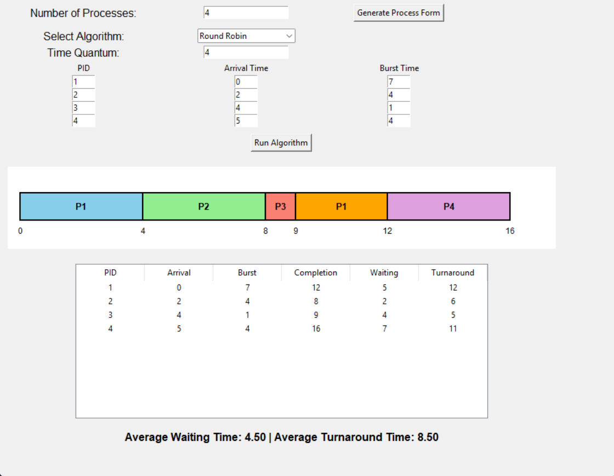

# CPU Scheduling Algorithm Simulator

A Python/Tkinter desktop application that simulates six classic CPU scheduling algorithms, draws the resulting schedule as a Gantt chart, and computes waiting and turnaround times. Built for an Operating Systems course.



## Features

- **Six scheduling algorithms**: First-Come-First-Served (FCFS), Shortest Job First (SJF), Shortest Remaining Time First (SRTF), Round Robin, Priority (non-preemptive), Priority (preemptive)
- **Dynamic input**: choose the number of processes, then enter arrival time, burst time, and (where relevant) priority or time quantum for each
- **Gantt chart** of the resulting execution order
- **Metrics**: completion, waiting, and turnaround time per process, plus the averages

## Project Structure

```
.
├── main.py                       # entry point
├── algorithms/
│   ├── fcfs.py
│   ├── sjf.py
│   ├── srtf.py
│   ├── round_robin.py
│   ├── priority_non_preemptive.py
│   └── priority_preemptive.py
├── ui/
│   └── gui.py                    # Tkinter interface
├── screenshots/                  # example runs of each algorithm
└── Report.os.pdf                 # written project report
```

## How to Run

Requires Python 3 (Tkinter ships with the standard Python installer).

```bash
python main.py
```

1. Enter the number of processes and click **Generate Process Form**.
2. Fill in the process details and pick an algorithm from the dropdown.
3. Click **Run Algorithm** to see the Gantt chart, the results table, and the averages.

## Example: Round Robin (quantum = 4)

| PID | Arrival | Burst | Completion | Waiting | Turnaround |
|-----|---------|-------|------------|---------|------------|
| 1   | 0       | 7     | 12         | 5       | 12         |
| 2   | 2       | 4     | 8          | 2       | 6          |
| 3   | 4       | 1     | 9          | 4       | 5          |
| 4   | 5       | 4     | 16         | 7       | 11         |

Average waiting time: 4.50, average turnaround time: 8.50

More example runs (FCFS, SJF, SRTF, both Priority variants, and Round Robin with other quanta) are in the `screenshots/` folder.

## Author

Maryam Taghinasab, individual project, Operating Systems course, University of Tehran
